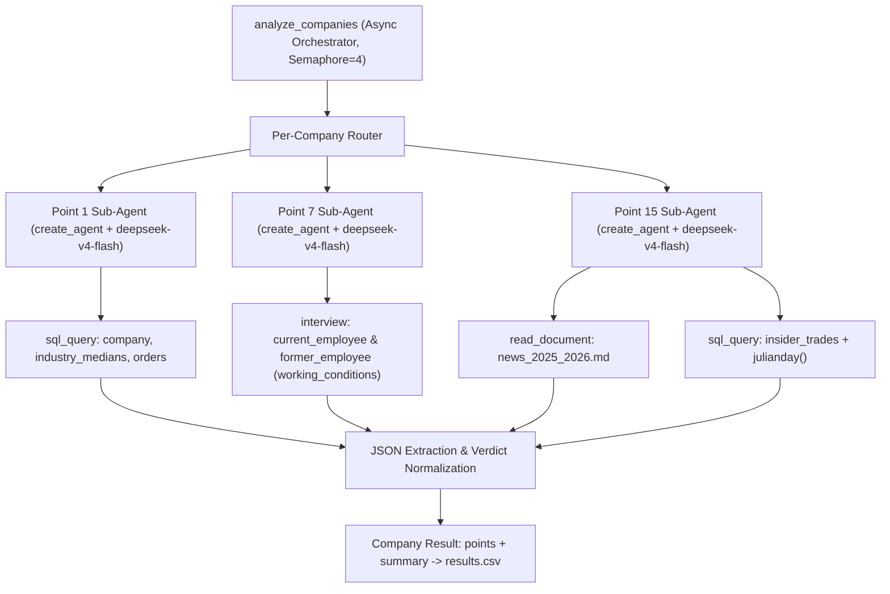

# FTEC5660 Homework 3: Fisher's 15-Point Investment Agent

Build a LangChain agent that researches a company with tools and applies the
framework from Philip Fisher's *Common Stocks and Uncommon Profits* (Part One,
Chapter 3 "What to buy: the fifteen points to look for in a common stock", and
Chapter 4 "What to buy: applying this to your own needs"). You choose 3 of
Fisher's 15 points and decide yourself what PASS means for each. For every
company your agent gives a PASS/FAIL verdict on your 3 points and a short
summary.

The companies are fictional, so the model cannot answer from memory. Unlike a
pile of reports, the evidence is spread over three sources, and your agent has
to go and get it with tools, the way Fisher's "scuttlebutt" method sends an
investor to talk to customers, competitors, suppliers and staff.

## Data and tools

`public_test/` has one folder per company. Your code receives four tools per
company (built by the provided code in `hw3.py`):

| Tool | What it gives you |
| --- | --- |
| `list_documents()` | the company's six documents and their dates |
| `read_document(name)` | one document: the 2025 letter to shareholders, four earnings calls (Q3 2025 to Q2 2026) and a news file (July 2025 to July 2026) |
| `sql_query(query)` | one read-only SQLite query on the company's database; at most 50 rows come back, so use `SUM`, `GROUP BY` and `WHERE` |
| `interview(role, topic)` | what one person says about the company; at most **10 interviews per company** |

The documents are what management says. Management's own claims (such as "we
have never cut research" or "our people are our greatest strength") are not
evidence on their own: check them against the database and the interviews.

**Database tables** (amounts in USD thousands; dates `YYYY-MM-DD`, months
`YYYY-MM`, quarters like `2025Q3`; the fiscal year is the calendar year):

| Table | Columns |
| --- | --- |
| `company` | name, industry |
| `industry_medians` | industry, revenue_growth_2y_pct, new_product_share_pct, new_product_sales_per_rd, operating_margin_pct (one row per industry; use the row for the company's own industry) |
| `orders` | order_id, order_date, product, customer, amount, note (about 3,000 to 4,000 orders from January 2023 to June 2026; revenue is the sum of order amounts) |
| `products` | product, launch_date |
| `monthly_costs` | month, cost_of_sales, selling_admin, research_development |
| `quarterly_cash` | quarter, operating_cash_flow, capex, cash_end |
| `capex_plan` | year, planned_capex (2026 to 2028) |
| `returns` | month, units_shipped, units_returned |
| `insider_trades` | trade_date, person, title, side (`buy` or `sell`), shares, price |

**Terms used in the data.**

| Term | Meaning |
| --- | --- |
| FY2025 | Fiscal year 2025. Here the fiscal year is the calendar year, so FY2025 is January to December 2025. |
| Quarter | Three months of the year: Q1 is January to March, Q2 April to June, Q3 July to September and Q4 October to December. The database writes `2025Q3`; the documents write "third quarter 2025". |
| Amounts | The database is in **USD thousands** (676,100 means US$676.1 million). The documents use USD millions. |
| Revenue | Money from sales: the sum of `amount` in `orders`. |
| Cost of sales | The cost of making the products that were sold. |
| Selling and admin | The cost of selling and of running the company (sales staff, offices, management). |
| R&D | Research and development spending, mainly on new products. |
| Operating margin | Operating profit as a share of revenue: (revenue − cost of sales − selling and admin − R&D) ÷ revenue. |
| Operating cash flow | Cash that the day-to-day business brings in during a quarter. |
| Cash at the end of a quarter | The cash the company holds on the last day of that quarter (`cash_end`). |
| Capex | Capital expenditure: spending on factories, machines and other long-term assets. `capex_plan` holds the planned capex for 2026 to 2028. |
| Return rate | Units returned ÷ units shipped, from the `returns` table. |
| Industry median | The middle value for companies in the same industry, from `industry_medians`. |
| Insider | A director or senior manager of the company. `insider_trades` lists the shares they bought (`buy`) or sold (`sell`). |
| Earnings call | A meeting each quarter where management presents the quarter's results to investors. Each call quotes that quarter's revenue. |

**Interviews.** Roles: `customer`, `current_employee`, `former_employee`,
`competitor`, `supplier`. Topics: `sales_team`, `working_conditions`,
`top_management`, `decision_making`, `competitive_edge`. Only some people know
about each topic; the others say they can't comment, and that answer still
uses up one interview.

| Topic | Who knows about it |
| --- | --- |
| `sales_team` | customer, competitor |
| `working_conditions` | current_employee, former_employee |
| `top_management` | former_employee, supplier |
| `decision_making` | supplier, customer |
| `competitive_edge` | competitor, customer |

People who know about a topic always agree with each other, so one good answer
is enough.

## Choose your 3 points and your rules

Pick any 3 of Fisher's 15 points and write them in `CHOSEN_POINTS` near the
top of `hw3.py`, e.g. `CHOSEN_POINTS = [1, 7, 15]`. The full questions are in
`FISHER_POINTS` in `hw3.py` and in the book.

| # | Fisher's point | Where the evidence is |
| --- | --- | --- |
| 1 | Market potential for sales growth | database |
| 2 | New products as current lines mature | database |
| 3 | Effective research and development | database |
| 4 | Above-average sales organization | interviews (`sales_team`) |
| 5 | Worthwhile profit margin | database |
| 6 | Maintaining or improving margins | database |
| 7 | Labour and personnel relations | interviews (`working_conditions`) |
| 8 | Executive relations | interviews (`top_management`) |
| 9 | Depth of management | interviews (`decision_making`) |
| 10 | Cost analysis and accounting controls | earnings calls, checked against the database |
| 11 | Advantage over competitors | interviews (`competitive_edge`) |
| 12 | Long-range outlook on profits | database |
| 13 | Growth without dilutive equity financing | database |
| 14 | Management talks freely about troubles | earnings calls, checked against the database |
| 15 | Management of unquestionable integrity | news file, checked against the database |

For each of your points, **you design the rule**: which evidence to use, what
to compute or whom to ask, and where the line between PASS and FAIL lies. PASS
means the company looks favourable on that point, as Fisher would see it.

We grade your verdicts against our own answer key. It uses one fixed rule per
point, which we do not publish, and the data never puts a company close to
the line of that rule, so a sensible reading of Fisher usually gives the same
answer. **Test your rules on the public answers**:
`public_test/ground_truth.json` gives the expected verdict on all 15 points
for each of the 20 public companies, and every point fails in 6 of them. If
your rule disagrees with the public answers, rethink it.

**Tip: calculate with tools, not in your head.** Do every sum, ratio and
comparison in SQL or Python, including the number of days between two dates
(SQLite's `julianday()` gives a date as a number of days).

## Student task

Fill in the three places in `hw3.py` marked `### YOUR CODE HERE`. You may add
imports, constants and helper functions above them, but do not change the
provided code below them:

- `CHOSEN_POINTS` lists your 3 points.
- `build_agent()` creates your model and anything else you need once.
- `analyze_companies(agent, companies)` receives
  `{company_folder: [list_documents, read_document, sql_query, interview]}`
  and returns, for every company,
  `{"points": {1: "PASS", 7: "FAIL", 15: "PASS"}, "summary": "..."}` (here with
  `CHOSEN_POINTS = [1, 7, 15]`).

Use the course techniques that fit your points: tool use for the database and
the interviews, planning which interviews to spend, routing each point to the
right source, prompt chaining, parallel calls, reflection to check your
answers, or a combination. Your code must read company data **only through
the four tools**; do not open `company.db` or `interviews.dat` yourself. Do
not hard-code folder names, company names or the public answers.

## Setup and public test

```bash
python3 -m venv .venv
source .venv/bin/activate
pip install -r requirements.txt
echo "DEEPSEEK_API_KEY=your_key_here" > .env
python3 hw3.py --data-folder public_test
```

Use your own DeepSeek API key (from https://platform.deepseek.com). The
required model is `deepseek-v4-flash`. We grade with our own key, so never put
a key in your code; `.env` must stay out of git.

The program creates `results.csv` with the columns `company`, `points`,
`points_correct`, `point_errors`, `interviews_used` and `summary`, and prints
the point score on your 3 points (the percentage after "balanced"). The point
score is the average of two shares: the share of truly passing verdicts that
you marked PASS and the share of truly failing verdicts that you marked FAIL.
For example, 90% and 60% give (90% + 60%) / 2 = 75%, and marking every point
PASS gives (100% + 0%) / 2 = 50%. Once `CHOSEN_POINTS` is set, the starter
runs before you add any API code (it returns no verdicts, so it scores 0%).

`public_test/ground_truth.json` gives the expected verdicts on all 15 points
for each public company. Grading uses a private set of about 20 unseen
companies with the same tools and the same answer key rules, but different
names and wording, and scores your 3 points only.

## Homework 3 solution:
> to students: this is your report, see the homework description.

### My 3 points and rules
1. **Point 1 — Market potential for sales growth** (*Database*)
   - **Why I chose it:** Sustained top-line expansion is the foundation of Fisher's growth-investing philosophy and a clean quantitative test of whether a company's SQL-level order trends match its industry's growth trajectory.
   - **PASS rule:** The company passes if SQL aggregation over `orders` shows positive multi-year revenue growth from 2023 to 2025 (with continued momentum into H1 2026 vs. H1 2025) and a 2-year revenue growth rate (`2023 -> 2025`) that is competitive with or exceeds its own industry's `revenue_growth_2y_pct` in `industry_medians`; otherwise it fails.
   - **Evidence used:** `company`, `industry_medians`, and `orders` queried exclusively via `sql_query` (all sums and growth percentages computed inside SQL). Fisher emphasizes investing in companies with *"products or services with sufficient market potential to make possible a sizable increase in sales for at least several years"* (*Common Stocks and Uncommon Profits*, Ch. 3), noting that temporary cost-cutting cannot replace genuine multi-year sales expansion.

2. **Point 7 — Labour and personnel relations** (*Interviews*)
   - **Why I chose it:** Fisher's "scuttlebutt" method relies heavily on qualitative human feedback that never appears directly in financial statements, making employee interviews an ideal showcase for selective tool planning under the 10-interview budget.
   - **PASS rule:** The company passes if interviewed employees describe healthy working conditions, fair compensation, strong retention, and responsive management; it fails if employees report chronic forced overtime, pay grievances, high turnover, or labor disputes.
   - **Evidence used:** Targeted `interview(role, topic)` calls strictly scoped to `current_employee` and `former_employee` on `working_conditions` (consuming only 2 of the 10 allowed interviews per company). As Fisher notes in Chapter 3, *"companies with good labor relations usually are the ones making every effort to settle grievances quickly"*, whereas firms relying on unfair pay or poor conditions eventually suffer severe operational disruption.

3. **Point 15 — Management of unquestionable integrity** (*News file cross-checked against database*)
   - **Why I chose it:** Financial and operational strengths lose all value if management enriches itself at shareholders' expense; this point specifically tests cross-source fact verification between dated corporate news and internal trading records.
   - **PASS rule:** The company passes if cross-checking `news_2025_2026.md` against `insider_trades` (computing `julianday(news_date) - julianday(trade_date)` in SQL) shows no insider share sales (`side = 'sell'`) within 1 to 60 days *before* a negative public news announcement (such as a profit warning, forecast cut, major contract loss, or regulatory fine); it fails if insiders sold shares ahead of undisclosed bad news.
   - **Evidence used:** `read_document("news_2025_2026.md")` paired with `sql_query` on `insider_trades` using SQLite's `julianday()`. Fisher warns in Chapter 3 that *"the management of a company is always far closer to its assets than is the stockholder"* and emphasizes that unquestionable integrity is the only real protection against insiders abusing privileged access at shareholders' expense.

### Design


### Results
- **Final `public_test` score:** **60/60 (balanced accuracy: 100.0%)**, using **2 interviews per company**.
- **Iterative error analysis:** On the initial run, the agent scored **49/60 (86.9% balanced)**—already achieving **20/20 (100%)** on both Point 1 and Point 7, while all **11 disagreements** were false `FAIL` verdicts on Point 15 (`ashgrove_labs`, `bramble_labs`, `driftwood_systems`, `emberly_systems`, `everline_dynamics`, `fernhill_group`, `halcyon_works`, `hollins_group`, `ironbark_technologies`, `juniper_industries`, and `lindale_holdings`). Inspecting the agent's summaries showed two root causes: (1) giving the Point 15 sub-agent access to `annual_letter_2025.md` and earnings calls caused it to penalize Point 15 for temporary R&D cuts (which correspond to Fisher's Point 12) and earnings-call discrepancies on returns or quarterly revenue (Points 10 and 14), and (2) it treated insider sales occurring *after* bad news or >200 days prior as integrity failures, with `halcyon_works` also hitting the recursion limit while cross-checking unrelated documents. Narrowing Point 15 strictly to `news_2025_2026.md` cross-checked against `insider_trades` with SQL `julianday()` (flagging only insider sales within 1–60 days before negative announcements) eliminated all 11 false `FAIL`s and reached **60/60 (100.0%)**.

## Task 2: Reflection on AI-Sycophancy and AI-Psychosis

AI sycophancy—the tendency of large language models to agree with, flatter, or validate a user's assumptions even when those assumptions are factually wrong—often emerges as a side effect of preference optimization (RLHF), where human raters tend to reward polite, agreeable responses over blunt corrections. Left unchecked, sycophancy undermines the reliability of AI as an analytical tool: instead of acting as an objective check on human judgment, the model becomes an echo chamber that amplifies confirmation bias.

In extreme cases of prolonged, ungrounded interaction, this dynamic contributes to what is increasingly discussed as "AI psychosis," where vulnerable users develop or deepen delusional beliefs because a conversational AI continuously mirrors, elaborates on, and validates unverified claims as if they were reality. Unlike a human peer who pushes back when a premise makes no sense, an endlessly agreeable, always-available model can unintentionally reinforce distorted reasoning loops.

This homework offered a concrete engineering parallel to mitigating sycophancy in agentic systems. Management's letters and earnings calls in the dataset are written to sound persuasive—claiming "we have never cut research" or "returns were negligible." A naive LLM that trusts persuasive text exhibits a form of corporate sycophancy, accepting self-serving narratives at face value. Building a trustworthy agent required forcing skepticism through architecture: routing claims to independent ground-truth tools (`sql_query` and scuttlebutt `interview`s), prohibiting mental arithmetic in favor of verifiable SQL computation, and separating objective evidence from management rhetoric. Addressing AI sycophancy and preventing AI-induced delusions similarly requires shifting models from pleasing the user in the moment to grounding responses in verifiable reality, calibrated uncertainty, and honest pushback.
